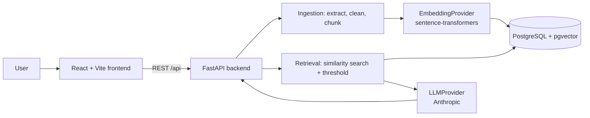

# AI Document Intelligence Platform

A web application for uploading documents (PDF, DOCX, TXT, Markdown) and asking questions about
them using Retrieval-Augmented Generation (RAG). Answers are grounded in the uploaded documents and
returned with structured citations. When the documents don't contain the answer, the system says so
instead of guessing.

> **Project status:** Core application features and a local RAG evaluation baseline are implemented.
> Production embedding/LLM providers, PostgreSQL/pgvector deployment, CI/CD and hardening remain.
> See [Roadmap](#roadmap).

## Problem

LLMs answer fluently whether or not they know the answer. For questions about private documents
(an HR policy, a contract, a handbook) an invented answer is worse than no answer. Models also
have no access to your documents, and pasting whole documents into a prompt doesn't scale.

## Solution

Retrieval-Augmented Generation: split documents into chunks, embed them, store the vectors, and at
question time retrieve only the most relevant chunks. The LLM is instructed to answer *only* from
that context and to cite it. If retrieval finds nothing sufficiently similar, the system declines to
answer rather than invoking the model on empty context.

## Target architecture

This diagram shows the target production design. The current local pipeline uses deterministic
hashing vectors, SQLite-compatible storage, and an extractive grounded answer builder.



Provider boundaries (`EmbeddingProvider`, `LLMProvider`, `VectorStore`) are interfaces, so the LLM,
embedding model or vector database can be swapped without touching the pipeline.

## Tech stack

| Layer | Choice | Why |
|---|---|---|
| Frontend | React 19, Vite, TypeScript, Tailwind CSS 4, Vitest | Fast dev loop, typed API layer |
| Backend | Python 3.12, FastAPI, pydantic-settings | Typed config and schemas, automatic OpenAPI docs |
| Database | PostgreSQL + pgvector *(Phase 2+)* | Relational data and vectors in one transactional store |
| Embeddings | sentence-transformers, `BAAI/bge-small-en-v1.5` *(Phase 5)* | Local, free, no API key |
| LLM | Anthropic behind an `LLMProvider` interface *(Phase 6)* | Replaceable provider |

No LangChain/LlamaIndex: the RAG pipeline is written directly so every step is visible.

## Repository layout

```
backend/
  app/
    api/         HTTP routers and dependencies (no business logic)
    core/        configuration, logging
    models/ schemas/ services/ rag/ ingestion/ embeddings/ retrieval/   (filled in by later phases)
    main.py      application factory: create_app() and ASGI app: app
  tests/
    unit/ integration/ pgvector/ e2e/
frontend/        Vite + React + TypeScript
evaluation/      RAG evaluation (Phase 9)
docker/  .github/workflows/   (Phase 10)
```

## Local setup

Prerequisites: Python 3.11+ (developed on 3.12), Node 20+.

```bash
cp .env.example .env            # backend configuration

# Backend
cd backend
python3 -m venv .venv && source .venv/bin/activate
pip install -r requirements-dev.txt
python -m uvicorn app.main:create_app --factory --reload --no-access-log
# API:      http://localhost:8000/api/health
# Swagger:  http://localhost:8000/api/docs

# Frontend (second terminal)
cd frontend
npm install
npm run dev
# App: http://localhost:5173  (proxies /api to the backend)
```

`--no-access-log` is intentional: the app writes its own request log (method, path, status,
duration) and omits query strings, which uvicorn's access log would print.

## Environment variables

| Variable | Default | Description |
|---|---|---|
| `APP_ENV` | `development` | `development`, `test` or `production` |
| `LOG_LEVEL` | `INFO` | `DEBUG`, `INFO`, `WARNING`, `ERROR`, `CRITICAL` |
| `LOG_FORMAT` | `console` | `console` (readable) or `json` (log aggregation) |
| `CORS_ALLOWED_ORIGINS` | `http://localhost:5173` | Comma-separated browser origins allowed to call the API |

Frontend (`frontend/.env`, optional, see `frontend/.env.example`): `VITE_API_PROXY_TARGET`,
`VITE_API_BASE_URL`. Never put secrets in `VITE_` variables: they are bundled into public JS.

## Testing

```bash
# Backend (from backend/)
python -m pytest                       # all tests; pgvector tests skip without a database
python -m pytest -m unit               # fast, no external services
python -m pytest -m integration        # multiple components, no PostgreSQL-specific features
TEST_DATABASE_URL=postgresql://... python -m pytest -m pgvector   # needs real PostgreSQL + pgvector
python -m pytest -m e2e                # against a running deployment
ruff check . && ruff format --check .

# Frontend (from frontend/)
npm test
npm run lint
npm run build
```

| Layer | Directory | Requires |
|---|---|---|
| unit | `tests/unit` | nothing |
| integration | `tests/integration` | nothing external (SQLite allowed) |
| pgvector | `tests/pgvector` | real PostgreSQL + pgvector; skipped unless `TEST_DATABASE_URL` is set |
| e2e | `tests/e2e` | running deployment |

Anything involving pgvector, vector similarity search, PostgreSQL-specific SQL, migrations or HNSW
indexes belongs in `tests/pgvector` and must pass against real PostgreSQL in CI. SQLite is used only
for tests that don't depend on PostgreSQL behaviour.

## Roadmap

| Phase | Scope | Status |
|---|---|---|
| 1 | Repository, FastAPI + React foundations, config, logging, health endpoint | Done |
| 2 | Database models and local SQLite setup (PostgreSQL/pgvector migrations remain) | Local complete |
| 3 | Authentication (JWT) | Done |
| 4 | Document upload, text extraction and chunk ingestion | Done |
| 5 | Embeddings and vector store | Local baseline; production vector store planned |
| 6 | Retrieval and grounded generation | Local baseline; production LLM planned |
| 7 | Citations and conversation history | Done |
| 8 | React frontend | Done |
| 9 | Test suite completion and RAG evaluation | Local baseline done |
| 10 | Docker and CI/CD | Planned |
| 11 | Production hardening | Planned |

Sections for the RAG pipeline, evaluation methodology, screenshots, deployment and future
improvements will be written as the corresponding features land.
